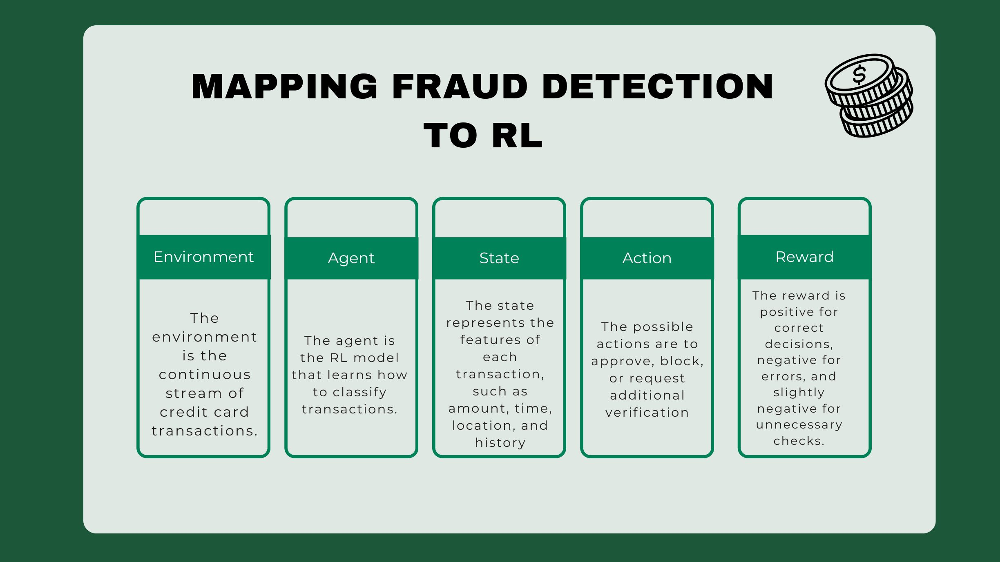
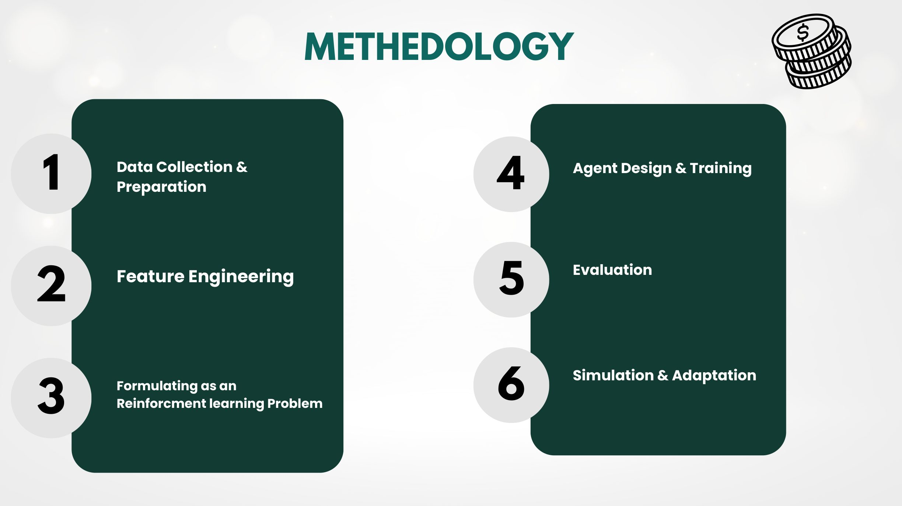
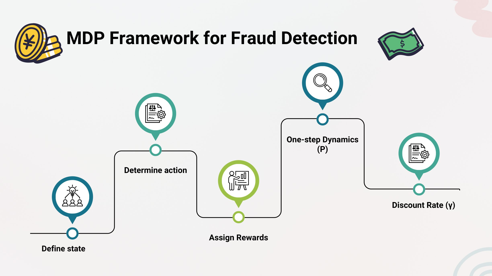
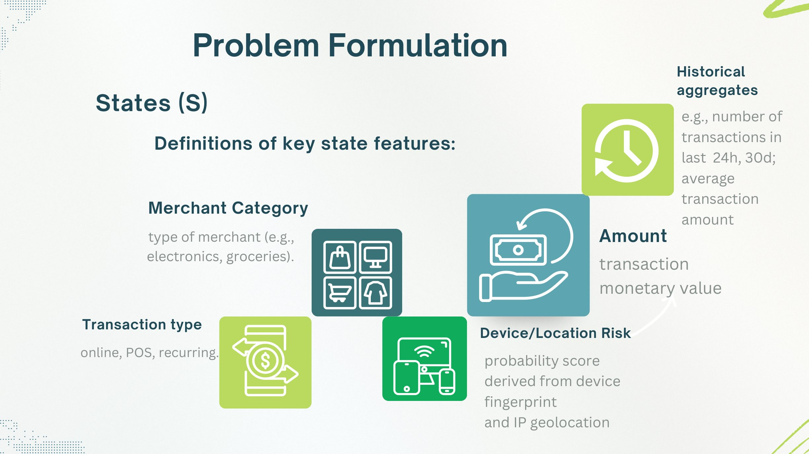
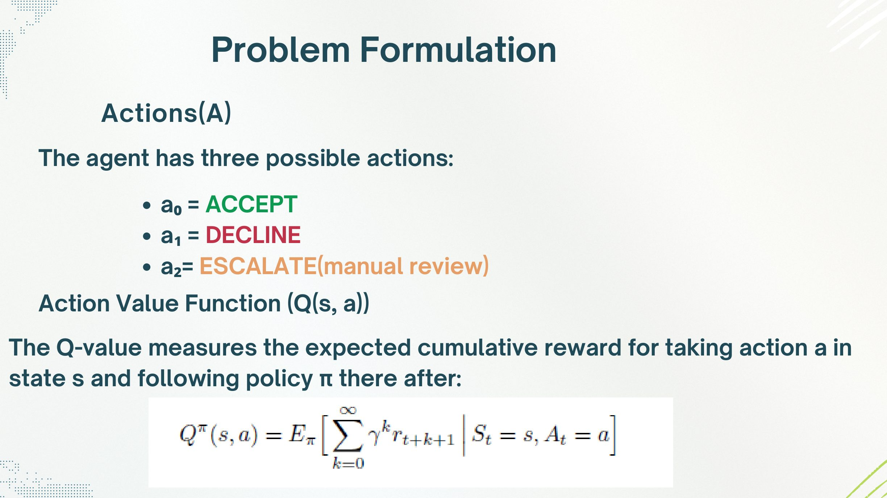
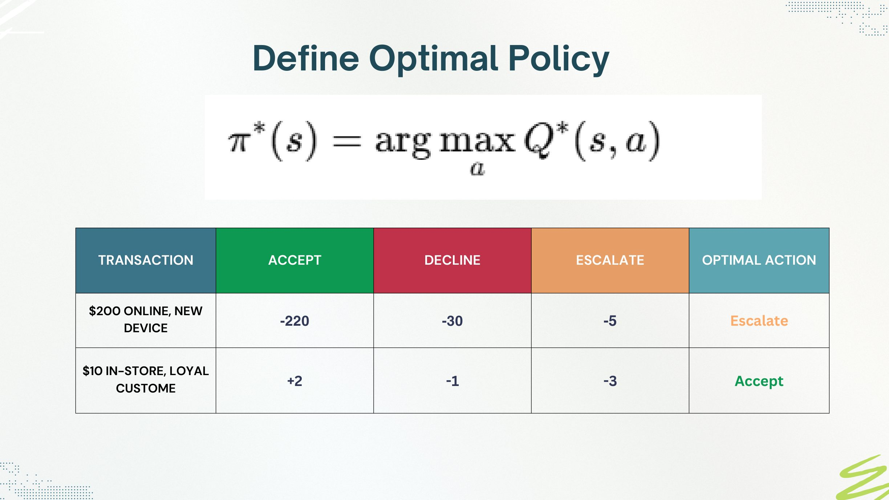
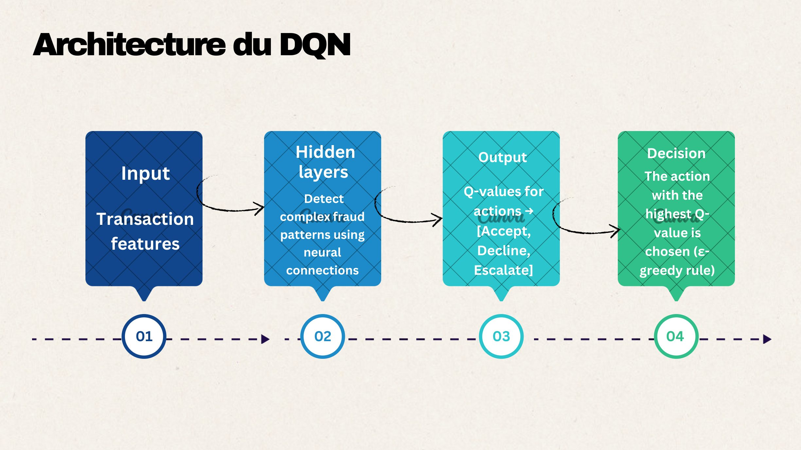
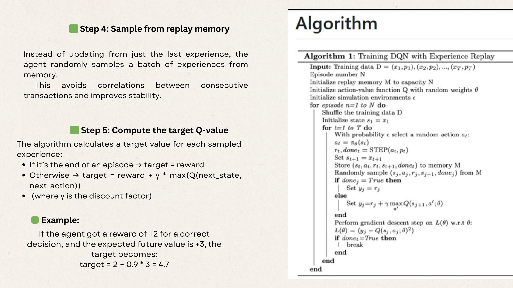
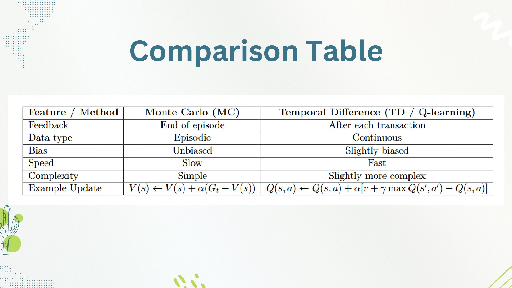
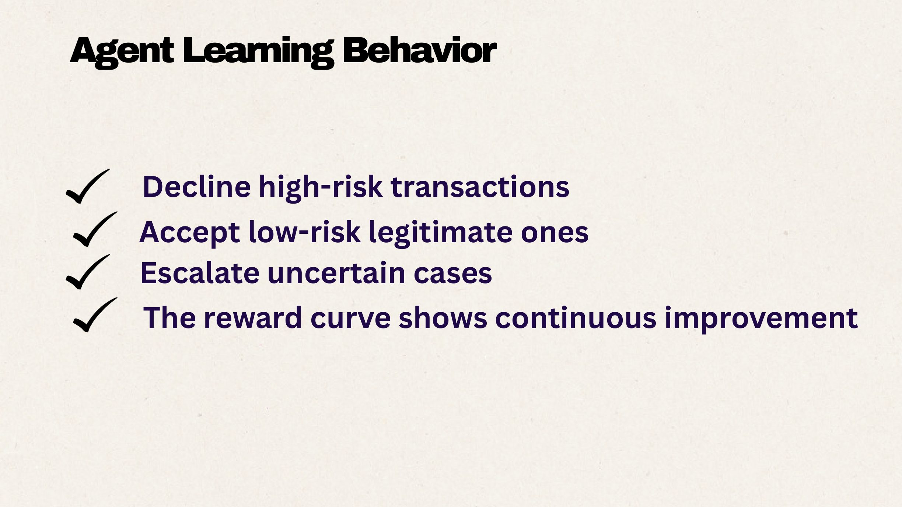

# Credit Card Fraud Detection with Deep Reinforcement Learning

**An academic project exploring cost-sensitive fraud screening as a sequential decision-making problem.**  
**Authors:** Sana Mkaouar & Arij Bouazizi · **Academic year:** 2025–2026

## Overview

This project explores how reinforcement learning can support credit-card transaction screening, with an agent choosing between **Accept**, **Decline**, and **Escalate for manual verification**. The goal is to balance fraud prevention against the costs of false positives, missed fraud, and unnecessary customer verification.

> **Project status:** Academic methodology, DQN design and comparative analysis. The provided materials do not establish a deployed production fraud detector or provide verified experimental performance metrics. The numerical reward and KPI examples are illustrative.

## Reinforcement Learning Architecture



### Workflow



1. Collect and clean transaction data, considering class imbalance.
2. Engineer transaction and behavioral risk features.
3. Formalize decisions as a Markov Decision Process (MDP).
4. Design and train a reinforcement-learning agent, such as a Deep Q-Network (DQN).
5. Evaluate detection quality and false-alarm costs.
6. Test in a simulated transaction stream.

## MDP Formulation



| MDP component | Fraud detection interpretation |
| --- | --- |
| **State** | Transaction amount, time, transaction type, merchant category, device/location risk and historical behavior |
| **Actions** | Accept, Decline, Escalate (manual review / verification) |
| **Reward** | Cost-sensitive feedback balancing fraud losses, legitimate transaction declines and review friction |
| **Transition** | The model's assumptions about how decisions relate to subsequent transaction states |
| **Discount factor (γ)** | Controls the weight of future outcomes relative to immediate rewards |



### Decision space and reward design





The illustrated example considers a risky transaction with expected action values of **−220 (Accept)**, **−30 (Decline)** and **−5 (Escalate)**. These are **teaching examples**, not measured business outcomes.

## DQN Design



The proposed DQN uses a neural network to approximate action values **Q(s, a)**. An **ε-greedy** policy balances exploration and exploitation. An experience replay buffer samples past transitions to support more stable training.



**Conceptual training loop:** observe transaction state → select an action → receive reward and next state → store experience → sample replay batch → update the Q-network.

### Monte Carlo vs Temporal Difference Learning



Monte Carlo learning updates from completed episodes. Temporal Difference / Q-learning updates estimates after individual transitions, making it a natural candidate for sequential transaction scenarios.

## Comparison: Q-Network γ = 0 vs DQN γ = 0.8

The companion comparative report discusses two reward horizons:

| Setting | Intended emphasis | Considerations |
| --- | --- | --- |
| **γ = 0** | Immediate rewards | Reactive but potentially sensitive to noisy rewards |
| **γ = 0.8** | Immediate and discounted future rewards | May encourage steadier policies while adding future-outcome dependence |

The report's metrics table contains **example placeholders**, not validation results. No measured precision, recall, AUC, F1 or latency is claimed here.

## Evaluation Plan

Key metrics: **precision, recall, F1-score, false-positive rate, false-negative rate, ROC-AUC, alert latency**, and action-specific financial costs. Evaluation should use held-out data, reproducible train/test splits and simulated changes in fraud patterns.



## Project Materials

This repository can contain the following documentation assets:

```text
.
├── README.md
└── docs/
    └── images/
        ├── rl-mapping.jpg
        ├── methodology.jpg
        ├── mdp-components.jpg
        ├── transaction-features.jpg
        ├── actions.jpg
        ├── cost-sensitive-decisions.jpg
        ├── mc-vs-td.jpg
        ├── dqn-architecture.jpg
        ├── experience-replay.jpg
        └── agent-behavior.jpg
```

*The supplied source documents are presentation decks and a comparative report. Executable source code, datasets, trained model weights and empirical test logs are not included in this documentation pack.*

## Future Work

- Implement a reproducible training environment and a DQN baseline.
- Benchmark against supervised classifiers on a properly held-out test set.
- Tune reward costs, discount factor and replay strategy.
- Evaluate model drift, fairness, explainability and review workload.

---


**Topic:** Reinforcement Learning · Deep Q-Networks · Fraud Detection · Decision Optimization
